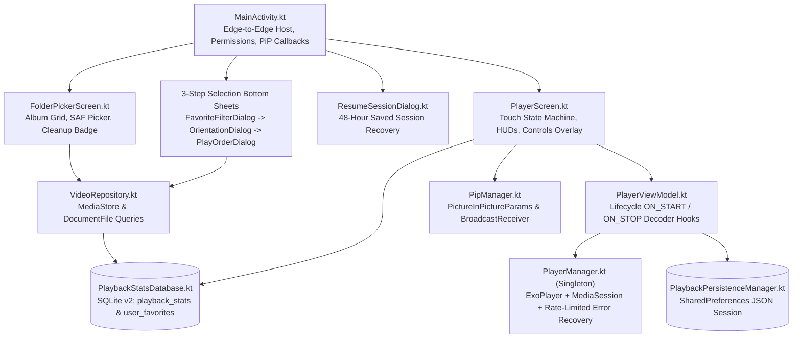

<p align="center">
  <a href="https://ko-fi.com/todd0042">
    
  </a>
</p>

---

# 🎬 Pixel Flow Player

[](app/build.gradle.kts)
[-3DDC84.svg?logo=android&logoColor=white)](app/build.gradle.kts)
[](build.gradle.kts)
[-A8C7FA.svg?logo=jetpackcompose&logoColor=white)](app/build.gradle.kts)
[](app/build.gradle.kts)
[](https://ko-fi.com/todd0042)

> **A fluid, gesture-driven, true edge-to-edge Android video player built with Kotlin, Jetpack Compose, and Media3 ExoPlayer—featuring orientation-filtered playlists, frame-accurate jog scrubbing, Google Photos favorites sync, Picture-in-Picture, and skipped-clip cleanup.**

---

## 📖 Table of Contents

* **Part 1 — User Overview & Quick Start**
  * [🎬 What Is Pixel Flow Player?](#-what-is-pixel-flow-player)
  * [⚡ How It Works in 3 Steps](#-how-it-works-in-3-steps)
  * [✨ Key Features at a Glance](#-key-features-at-a-glance)
  * [🎮 Gesture and Playback Controls](#-gesture-and-playback-controls)
  * [🚀 Quick Start, Build and Installation](#-quick-start-build-and-installation)
* **Part 2 — Technical Architecture & Reference**
  * [1. System Architecture and Lifecycle-Managed Media3 Engine ([MainActivity.kt](app/src/main/java/com/pixelflow/player/MainActivity.kt), [PlayerManager.kt](app/src/main/java/com/pixelflow/player/service/PlayerManager.kt))](#1-system-architecture-and-lifecycle-managed-media3-engine)
  * [2. Media Discovery, Orientation Math and SAF Access ([VideoRepository.kt](app/src/main/java/com/pixelflow/player/data/VideoRepository.kt), [VideoItem.kt](app/src/main/java/com/pixelflow/player/data/VideoItem.kt))](#2-media-discovery-orientation-math-and-saf-access)
  * [3. Touch Gesture State Machine, Scrubbing and Frame Jogging ([PlayerScreen.kt](app/src/main/java/com/pixelflow/player/ui/screens/PlayerScreen.kt), [TimelineThumbnailPreview.kt](app/src/main/java/com/pixelflow/player/ui/components/TimelineThumbnailPreview.kt))](#3-touch-gesture-state-machine-scrubbing-and-frame-jogging)
  * [4. Picture-in-Picture and MediaSession Integration ([PipManager.kt](app/src/main/java/com/pixelflow/player/pip/PipManager.kt), [PlayerManager.kt](app/src/main/java/com/pixelflow/player/service/PlayerManager.kt))](#4-picture-in-picture-and-mediasession-integration)
  * [5. Session Persistence, Playback Stats, Favorites and Cleanup ([PlaybackPersistenceManager.kt](app/src/main/java/com/pixelflow/player/data/PlaybackPersistenceManager.kt), [PlaybackStatsDatabase.kt](app/src/main/java/com/pixelflow/player/data/PlaybackStatsDatabase.kt))](#5-session-persistence-playback-stats-favorites-and-cleanup)
  * [6. Permissions, Theme and Gradle Configuration ([AndroidManifest.xml](app/src/main/AndroidManifest.xml), [app/build.gradle.kts](app/build.gradle.kts))](#6-permissions-theme-and-gradle-configuration)
  * [7. Repository Structure](#7-repository-structure)
  * [8. Build Verification and Device Testing](#8-build-verification-and-device-testing)
  * [9. Privacy, Licensing and Support](#9-privacy-licensing-and-support)

---

# Part 1 — User Overview & Quick Start

## 🎬 What Is Pixel Flow Player?

**Pixel Flow Player** (`Pixel Flow`) is a native Android video player crafted for Google Pixel and modern Android devices (`Android 8.0+`, API 26–35). Instead of cluttering playback with persistent chrome or mixing vertical phone clips with widescreen footage, Pixel Flow separates your library into clean **Portrait** and **Landscape** feeds and puts precision transport controls right under your thumb.

Whether you are binge-watching camera roll reels, reviewing slow-motion footage frame by frame (`-1 FR` / `+1 FR` / `1 FPS` mode), or decluttering repeatedly skipped clips straight to Trash, everything happens locally on-device with zero network dependencies.

---

## ⚡ How It Works in 3 Steps

1. **Pick a Source Album or Custom Folder**: Launch Pixel Flow to browse auto-discovered **All Albums**, **Favorites**, and device video buckets (with **Camera** pinned first and per-album Portrait/Landscape counts), or tap the folder icon to open any directory via Android's Storage Access Framework (SAF).
2. **Filter, Orient & Order Your Feed**: Choose a 3-step playback slice:
   * **Filter**: `All Videos`, `Favorites Only`, `Non-Favorites Only`, or `Unviewed Non-Favorites`.
   * **Orientation**: `Portrait (Vertical)` or `Landscape (Horizontal)`—automatically locking screen orientation to match.
   * **Play Order**: `Newest First`, `Oldest First`, `Longest First`, or `Random`.
3. **Flow Through Your Videos**: Swipe up/down to move through the looping playlist, scrub smoothly forward or backward by drag velocity, pinch to zoom up to `5.0x`, long-press to sync Favorites with Google Photos, or drop into Picture-in-Picture (`PiP`) when multitasking.

---

## ✨ Key Features at a Glance

* **📂 Album Grid & Storage Access Framework (SAF) Picker**: Displays video frame cover art via Coil's `VideoFrameDecoder`, virtual **All Albums** and **Favorites** collections, per-folder Portrait/Landscape counts, and direct SAF tree browsing for `.mp4`, `.mkv`, `.mov`, `.webm`, `.3gp`, `.avi`, and `.ts` files.
* **🧭 Rotation-Aware Orientation Filtering**: Accurately separates Portrait vs. Landscape clips by factoring in `90°` and `270°` rotation metadata from MediaStore and `MediaMetadataRetriever`.
* **🖼️ True Edge-to-Edge Fullscreen**: Draws behind the camera cutout (`LAYOUT_IN_DISPLAY_CUTOUT_MODE_SHORT_EDGES`), keeps the screen awake during playback, and hides system bars with transient swipe reveal (`BEHAVIOR_SHOW_TRANSIENT_BARS_BY_SWIPE`).
* **🎞️ Precision Scrubbing, Frame Stepping & 1 FPS Mode**:
  * **Velocity Scrubbing (`0.1x–7.5x`)** when dragging horizontally while playing—including smooth decoder-gated reverse scrubbing (`CLOSEST_SYNC` at `55ms` intervals).
  * **Paused Jog-Shuttle** when dragging horizontally while paused, stepping frame by frame with exact seeking.
  * **Overlay `-1 FR` / `+1 FR` buttons** and a dedicated **`1 FPS` mode** that mutes audio and slows playback to `1 / fps` for clean visual inspection.
  * **Timeline Thumbnail Preview**: Hovering frame preview bubble above the scrubber thumb with timestamp badge.
* **⚡ Variable Speed (`0.1x–10.0x`) & 2.0x Hold Boost**: Press and hold either side of the screen for temporary `2.0x` playback, or open the Speed menu for `-50%` / `+25%` steppers and direct decimal input.
* **❤️ Google Photos Favorites Sync**: Long-press the center of the screen (or tap the heart icon) to toggle favorites—persisted locally in SQLite and synced via `MediaStore.createFavoriteRequest` on Android 11+.
* **🧹 Smart Skipped-Video Cleanup**: Tracks views and skips in a local SQLite database (`pixelflow_playback_stats.db`). Non-favorite videos skipped `5+` times surface in a top-bar badge (`DeleteSweep`) so you can review thumbnails, file sizes, and batch-move unwanted clips to Trash.
* **📺 Picture-in-Picture (PiP) & MediaSession**: Auto-enters PiP on leave (Android 12+ seamless resize) or via a two-finger swipe down, complete with floating **Previous**, **Play/Pause**, and **Next** actions plus `MediaSession` metadata for Bluetooth and Android Auto.
* **💾 Self-Healing Session Resume**: Saves active folder, filter, orientation, play order, video ID, and millisecond position on stop/error and offers a **Resume Playback?** prompt if reopened within 48 hours.

---

## 🎮 Gesture and Playback Controls

| Gesture / Control | Zone / Condition | Action |
| :--- | :--- | :--- |
| **Swipe Up** | Middle `70%` width, top `2/3` height (unzoomed) | Next video in playlist (wraps around) |
| **Swipe Down** | Middle `70%` width (unzoomed) | Previous video in playlist (wraps around) |
| **Horizontal Drag (Playing)** | Anywhere (after `25px` deadzone) | Velocity-curved scrubbing (`0.1x` to `7.5x` forward/reverse) |
| **Horizontal Drag (Paused)** | Anywhere (`14px` per frame) | Precision frame-by-frame Jog-Shuttle (`±N Frames`) |
| **Vertical Drag (Left Edge)** | Left `15%` of screen | Adjusts window screen brightness (`1%–100%`) |
| **Vertical Drag (Right Edge)** | Right `15%` of screen | Adjusts media stream volume (`0%–100%`) |
| **Press & Hold (`380ms`)** | Left `< 35%` or Right `> 65%` while playing | Temporary `2.0x` speed boost until release |
| **Long-Press** | Center `35%–65%` width (idle, unzoomed) | Toggle Favorite (syncs with Google Photos) |
| **Single-Tap** | Anywhere (`320ms` disambiguation) | Show / hide playback overlay controls |
| **Double-Tap Middle** | Middle `1/3` width | Cycle aspect mode (`Fit to Screen` → `Crop to Fill` → `Stretch to Fill`) |
| **Double / Multi-Tap Sides** | Left `< 1/3` or Right `> 2/3` (`650ms` chain) | Jump `-5s` / `+5s` per tap (`-10s`, `-15s`, etc.) |
| **Pinch-to-Zoom & Pan** | Two fingers (`1.0x–5.0x`) | Focal-anchored zoom & pan; double-tap or Back resets to `1.0x` |
| **Two-Finger Tap** | Quick tap (`< 280ms`, `< 35px` drift) | Toggle Play / Pause |
| **Two-Finger Swipe Down** | Downward centroid drag `> 150px` (unzoomed) | Enter Picture-in-Picture (PiP) mode |

---

## 🚀 Quick Start, Build and Installation

### Prerequisites
* **Android Studio** or **JDK 17** with the **Android SDK** (`compileSdk 35`, Android 15).
* **ADB** (`adb`) and a physical Android device (`minSdk 26` / Android 8.0+) or emulator with USB debugging enabled.
* Local SDK path configured in `local.properties` (ignored by Git).

### Build & Install via Gradle + ADB
```bash
# 1. Clone the repository
git clone https://github.com/Todd0042/pixel-flow-player.git
cd pixel-flow-player

# 2. Build the debug APK
./gradlew assembleDebug

# 3. Install on a connected device
adb install -r app/build/outputs/apk/debug/app-debug.apk
```

### One-Command Helper Script ([install.sh](install.sh))
The included [install.sh](install.sh) script checks `adb devices`, builds `app/build/outputs/apk/debug/app-debug.apk` if missing, installs it with `adb install -r`, and launches `com.pixelflow.player`:
```bash
./install.sh
```

> [!NOTE]
> If you make code edits after an initial build, run `./gradlew assembleDebug` (or delete the existing `app-debug.apk`) before running `./install.sh`, because `install.sh` skips `./gradlew assembleDebug` when the APK file already exists.

---
---

# Part 2 — Technical Architecture & Reference

> *The sections below provide a code-verified technical reference for every module, data model, gesture state transition, lifecycle hook, and build configuration in Pixel Flow Player `v1.0.0`.*

---

## 1. System Architecture and Lifecycle-Managed Media3 Engine

Pixel Flow uses a single-activity **Jetpack Compose** UI hosted by [`MainActivity`](app/src/main/java/com/pixelflow/player/MainActivity.kt), backed by a singleton [`PlayerManager`](app/src/main/java/com/pixelflow/player/service/PlayerManager.kt) and lifecycle-aware [`PlayerViewModel`](app/src/main/java/com/pixelflow/player/ui/screens/PlayerViewModel.kt).



### Singleton ExoPlayer & Decoder Recovery ([PlayerManager.kt](app/src/main/java/com/pixelflow/player/service/PlayerManager.kt), [PlayerViewModel.kt](app/src/main/java/com/pixelflow/player/ui/screens/PlayerViewModel.kt))
* **Audio & Wake Configuration**: [`PlayerManager`](app/src/main/java/com/pixelflow/player/service/PlayerManager.kt) initializes `ExoPlayer` with `AudioAttributes` (`C.USAGE_MEDIA`, `C.AUDIO_CONTENT_TYPE_MOVIE`, `handleAudioFocus = true`), `C.WAKE_MODE_LOCAL`, `SeekParameters.EXACT`, `playWhenReady = true`, and `Player.REPEAT_MODE_ALL`.
* **Voluntary Decoder Release on Backgrounding**: When the user leaves the app while *not* in PiP mode, [`PlayerViewModel.onLifecycleStop()`](app/src/main/java/com/pixelflow/player/ui/screens/PlayerViewModel.kt) persists the active playback state and calls `player.stop()` to release hardware video decoder codecs gracefully. On `ON_START`, [`onLifecycleStart()`](app/src/main/java/com/pixelflow/player/ui/screens/PlayerViewModel.kt) detects `Player.STATE_IDLE`, sets `isRecoveringDecoder = true` (surfacing a *"Reconnecting decoder... Tap to resume"* pill), calls `player.prepare()`, and seeks back to `(targetIndex, targetPositionMs)`.
* **Infinite-Loop Guard on `onPlayerError`**: Inside [`PlayerManager`](app/src/main/java/com/pixelflow/player/service/PlayerManager.kt), `onPlayerError` allows at most `2` automatic `player.prepare()` retries within a `3000ms` window before suppressing further retries (`errorRetryCount > 2`) to prevent infinite error-prepare loops.
* **Memory Management**: Both `PlayerView.player = null` in Compose `onRelease` / `onDispose` and `android:largeHeap="true"` in [AndroidManifest.xml](app/src/main/AndroidManifest.xml) prevent `PlayerView`/surface leaks across playlist transitions.

---

## 2. Media Discovery, Orientation Math and SAF Access

All media scanning and filtering live in [`VideoRepository`](app/src/main/java/com/pixelflow/player/data/VideoRepository.kt) and [`VideoItem`](app/src/main/java/com/pixelflow/player/data/VideoItem.kt):

* **MediaStore Query & Virtual Albums**:
  * Queries `MediaStore.Video.Media.EXTERNAL_CONTENT_URI` sorted by `DATE_ADDED DESC`, reading `ORIENTATION` (API 29+) and `IS_FAVORITE` (API 30+).
  * Merges local overrides from `PlaybackStatsDatabase.getFavoritesMap()` and injects two virtual albums ahead of physical buckets:
    * **`All Albums`** (`ALL_VIDEOS_BUCKET_ID`): Aggregates every discovered video on the device.
    * **`Favorites`** (`FAVORITES_BUCKET_ID`): Aggregates all favorited videos across buckets.
  * Physical folders sort with `"Camera"` (case-insensitive) first, then descending by `totalCount`.
* **Storage Access Framework (`OpenDocumentTree`)**:
  * [`FolderPickerScreen`](app/src/main/java/com/pixelflow/player/ui/screens/FolderPickerScreen.kt) launches `ActivityResultContracts.OpenDocumentTree()`, persists `FLAG_GRANT_READ_URI_PERMISSION`, and scans `DocumentFile` children matching `video/*` MIME types or extensions (`.mp4`, `.mkv`, `.mov`, `.webm`, `.3gp`, `.avi`, `.ts`).
  * Missing dimensions/duration/rotation (for SAF files or zeroed MediaStore rows) are extracted via `MediaMetadataRetriever` (`METADATA_KEY_VIDEO_WIDTH`, `METADATA_KEY_VIDEO_HEIGHT`, `METADATA_KEY_VIDEO_ROTATION`, `METADATA_KEY_DURATION`).
* **Rotation-Corrected Orientation Classification ([VideoItem.kt](app/src/main/java/com/pixelflow/player/data/VideoItem.kt))**:
  ```kotlin
  val effectiveWidth: Int
      get() = if (rotationDegrees == 90 || rotationDegrees == 270) height else width
  val effectiveHeight: Int
      get() = if (rotationDegrees == 90 || rotationDegrees == 270) width else height
  val isPortrait: Boolean
      get() = effectiveHeight >= effectiveWidth
  val isLandscape: Boolean
      get() = effectiveWidth > effectiveHeight
  ```
* **Filter & Sort Pipeline ([FavoriteFilter.kt](app/src/main/java/com/pixelflow/player/data/FavoriteFilter.kt), [PlayOrder.kt](app/src/main/java/com/pixelflow/player/data/PlayOrder.kt))**:
  * Filters by `ALL`, `FAVORITES_ONLY`, `NON_FAVORITES_ONLY`, or `NON_FAVORITES_UNVIEWED` (checked against `PlaybackStatsDatabase.getViewedUriStrings()`).
  * Sorts by `NEWEST` (`dateAdded` desc), `OLDEST` (`dateAdded` asc), `LONGEST` (`durationMs` desc), or `RANDOM` (`shuffled()`).

---

## 3. Touch Gesture State Machine, Scrubbing and Frame Jogging

[`PlayerScreen`](app/src/main/java/com/pixelflow/player/ui/screens/PlayerScreen.kt) coordinates `ScaleGestureDetector`, `GestureDetector`, and raw `MotionEvent` tracking through an explicit `TouchGestureState` enum:

```text
IDLE ──┬──► BRIGHTNESS_SLIDER  (touchDownX < 15% width, |dy| > 25px, |dy| > 1.5*|dx|)
       ├──► VOLUME_SLIDER      (touchDownX > 85% width, |dy| > 25px, |dy| > 1.5*|dx|)
       ├──► SPEED_BOOST        (hold 380ms on < 35% or > 65% width while playing -> 2.0x)
       ├──► JOG_SHUTTLE        (paused + |dx| > 30px, |dx| > 1.2*|dy|)
       ├──► SCRUBBING          (playing + |dx| > 30px, |dx| > 1.2*|dy|)
       ├──► VERTICAL_SWIPE     (15%–85% width, |dy| > 20px, |dy| > 1.1*|dx|)
       └──► PINCH_ZOOM         (ScaleGestureDetector.onScaleBegin)
```

* **Velocity Scrubbing Curve (`0.1x`–`7.5x`)**:
  * Beyond a `25px` deadzone (within `maxDist = 0.45 * viewWidth`), normalized drag distance `norm` maps to playback speed via:
    $$\text{speed} = \text{clamp}\left(0.1 + 7.4 \cdot \text{norm}^{1.5},\; 0.1,\; 7.5\right)$$
  * **Forward Scrub**: Updates `exoPlayer.setPlaybackSpeed(roundedSpeed)` with audio muted (`volume = 0f`).
  * **Reverse Scrub**: Pauses ExoPlayer, advances a simulated playhead every `33ms`, and dispatches `SeekParameters.CLOSEST_SYNC` seeks throttled at `55ms` (`minIntervalMs = 55L`) guarded by `isSeekInProgress` / `pendingSeekPositionMs` so pending seeks flush on `STATE_READY`, `DISCONTINUITY_REASON_SEEK`, or `onRenderedFirstFrame`. On `ACTION_UP`, restores `SeekParameters.EXACT` and previous play/pause state.
* **Paused Precision Jog-Shuttle & `1 FPS` Mode**:
  * While paused, dragging horizontally steps `frames = (deltaX / 14f).toInt()` using detected `videoFormat.frameRate` (fallback `30f`), dispatching `SeekParameters.EXACT` at `75ms` intervals and updating [`JogFrameHud`](app/src/main/java/com/pixelflow/player/ui/components/JogFrameHud.kt).
  * Toggling **`1 FPS`** in the overlay disables `C.TRACK_TYPE_AUDIO` via `trackSelectionParameters`, sets `volume = 0f`, and sets speed to `(1f / fps).coerceIn(0.005f, 0.1f)` so `StandaloneMediaClock` drives smooth frame-by-frame playback without audio buffer stalls.
* **Floating Timeline Thumbnail Preview ([TimelineThumbnailPreview.kt](app/src/main/java/com/pixelflow/player/ui/components/TimelineThumbnailPreview.kt))**:
  * Tracks slider thumb position with boundary clamping and a downward caret arrow.
  * Quantizes frame requests by video length (`250ms` for clips `<= 2m`, `500ms` for `> 2m`, `1000ms` for `> 10m`) and debounces `45ms` before requesting the frame via Coil's `VideoFrameDecoder`.

---

## 4. Picture-in-Picture and MediaSession Integration

* **Picture-in-Picture ([PipManager.kt](app/src/main/java/com/pixelflow/player/pip/PipManager.kt))**:
  * Enabled on `MainActivity` (`android:supportsPictureInPicture="true"`).
  * Clamps video aspect ratios to `[0.42, 2.38]` via `getClampedAspectRatio()` to satisfy Android system PiP bounds.
  * On Android 12+ (`API 31+`), configures `setAutoEnterEnabled` (automatically disabled while actively scrubbing the timeline or waiting on a MediaStore permission dialog) and `setSeamlessResizeEnabled(true)`. Falls back to `onUserLeaveHint()` on Android 8–11.
  * Attaches 3 `RemoteAction` buttons (`ACTION_PIP_PREVIOUS`, `ACTION_PIP_PLAY_PAUSE`, `ACTION_PIP_NEXT`) handled by a `ContextCompat.RECEIVER_NOT_EXPORTED` `BroadcastReceiver`.
* **Global `MediaSession` ([PlayerManager.kt](app/src/main/java/com/pixelflow/player/service/PlayerManager.kt), [PlayerScreen.kt](app/src/main/java/com/pixelflow/player/ui/screens/PlayerScreen.kt))**:
  * Registers `MediaSession` (`"PixelFlowGlobalSession"`) bound to `MainActivity` with `FLAG_ACTIVITY_SINGLE_TOP` and populates each `MediaItem` with `MediaMetadata` (`title`, `artist` = folder name, `albumTitle` = folder name) for lock-screen, Bluetooth, and Android Auto head-unit controls.

---

## 5. Session Persistence, Playback Stats, Favorites and Cleanup

* **48-Hour Session Persistence ([PlaybackPersistenceManager.kt](app/src/main/java/com/pixelflow/player/data/PlaybackPersistenceManager.kt))**:
  * Serializes `SavedPlaybackSession` (`bucketId`, `folderName`, `favoriteFilter`, `orientation`, `playOrder`, `currentVideoId`, `currentVideoTitle`, `currentPositionMs`, `playlistVideoIds`, `timestamp`, virtual/SAF flags, `treeUri`) to `SharedPreferences` (`pixelflow_playback_state`).
  * `MainActivity` prompts [`ResumeSessionDialog`](app/src/main/java/com/pixelflow/player/ui/components/ResumeSessionDialog.kt) whenever storage permissions are granted and the saved timestamp is under `48 hours` old.
* **SQLite Playback Stats & Favorites DB ([PlaybackStatsDatabase.kt](app/src/main/java/com/pixelflow/player/data/PlaybackStatsDatabase.kt))**:
  * Database `pixelflow_playback_stats.db` (`DATABASE_VERSION = 2`) maintains:
    * `playback_stats` (`uri` PK, `bucket_id`, `view_count`, `skip_count`, `last_viewed_at`, `last_skipped_at`)
    * `user_favorites` (`uri` PK, `is_favorite`, `updated_at`)
  * **View vs. Skip Threshold**: On manual skip (`skipToNext` / `skipToPrevious`), a clip counts as **viewed** if `duration in 1..4999ms` and `watchedMs >= 50%`, or if `watchedMs >= 5000ms` or `watchedMs >= 90%` of duration; otherwise `skip_count` increments.
* **MediaStore Favorites & Trash Flows ([FavoritesHelper.kt](app/src/main/java/com/pixelflow/player/data/FavoritesHelper.kt), [DeleteHelper.kt](app/src/main/java/com/pixelflow/player/data/DeleteHelper.kt), [SkippedCleanupDialog.kt](app/src/main/java/com/pixelflow/player/ui/components/SkippedCleanupDialog.kt))**:
  * `FavoritesHelper.resolveMediaStoreUri()` maps both `MediaStore` URIs and SAF document URIs back to `MediaStore.Video.Media.EXTERNAL_CONTENT_URI` rows (matching by `DISPLAY_NAME` + `SIZE`, then `DISPLAY_NAME`).
  * Toggling a favorite writes immediately to `user_favorites`, attempts direct `ContentResolver.update`, and falls back to `MediaStore.createFavoriteRequest` (API 30+), reverting local state if the user cancels the system prompt.
  * [`SkippedCleanupDialog`](app/src/main/java/com/pixelflow/player/ui/components/SkippedCleanupDialog.kt) queries videos with `skip_count >= 5` and `!isFavorite`, displays total reclaimable bytes, and invokes `MediaStore.createDeleteRequest` (API 30+) or `DeleteHelper.directDelete()` (API < 30 / SAF) while purging deleted URIs from `playback_stats`.

---

## 6. Permissions, Theme and Gradle Configuration

### Declared Permissions ([AndroidManifest.xml](app/src/main/AndroidManifest.xml))
| Permission | Scope / SDK Constraint | Purpose |
| :--- | :--- | :--- |
| `READ_MEDIA_VIDEO` | Android 13+ (API 33+) | Discover local video albums via MediaStore |
| `READ_MEDIA_VISUAL_USER_SELECTED` | Android 14+ (API 34+) | Support partial/selected photo & video access |
| `READ_EXTERNAL_STORAGE` | `maxSdkVersion="32"` | Legacy external storage read access on Android 8–12 |
| `VIBRATE` | All APIs | Haptic feedback on gestures, scaling, and favorites |
| `WAKE_LOCK` | All APIs | Prevent CPU/screen sleep during playback (`C.WAKE_MODE_LOCAL`) |
| `MODIFY_AUDIO_SETTINGS` | All APIs | Media volume edge slider and audio focus management |
| `BLUETOOTH_CONNECT` | `minSdkVersion="31"` | Bluetooth media button / audio routing integration |
| `POST_NOTIFICATIONS` | `minSdkVersion="33"` | MediaSession playback notification support |

### Theme & Visual Tokens ([Theme.kt](app/src/main/java/com/pixelflow/player/ui/theme/Theme.kt), [Color.kt](app/src/main/java/com/pixelflow/player/ui/theme/Color.kt))
* [`PixelFlowTheme`](app/src/main/java/com/pixelflow/player/ui/theme/Theme.kt) enables Material 3 **Dynamic Color** (`dynamicDarkColorScheme` / `dynamicLightColorScheme`) on Android 12+ (`API 31+`), falling back to `PixelDarkSurface` (`#121316`), `PixelDarkSurfaceVariant` (`#1E2024`), `PixelAccentBlue` (`#A8C7FA`), and `PixelHeartRed` (`#FF4B4B`).

### Key Build & Dependency Versions ([build.gradle.kts](build.gradle.kts), [app/build.gradle.kts](app/build.gradle.kts), [gradle.properties](gradle.properties))
| Component | Version / Setting |
| :--- | :--- |
| **Gradle Wrapper** | `8.14` ([gradle-wrapper.properties](gradle/wrapper/gradle-wrapper.properties)) |
| **Android Gradle Plugin** | `8.7.3` |
| **Kotlin / Compose Plugin** | `2.0.21` (JVM target `17`) |
| **SDK Targets** | `minSdk = 26`, `compileSdk = 35`, `targetSdk = 35` |
| **Compose BOM** | `2024.10.01` (`material3`, `material-icons-extended`, `ui-tooling-preview`) |
| **AndroidX Media3** | `1.5.1` (`exoplayer`, `ui`, `common`, `session`) |
| **Coil** | `2.7.0` (`coil-compose`, `coil-video`) |
| **AndroidX DocumentFile** | `1.0.1` |
| **Kotlinx Coroutines** | `1.9.0` |

---

## 7. Repository Structure

```text
pixel-flow-player/
├── build.gradle.kts                                         # Root Gradle plugin declarations (AGP 8.7.3, Kotlin 2.0.21)
├── settings.gradle.kts                                      # Root project ("PixelFlowPlayer") & :app module include
├── gradle.properties                                        # JVM args (-Xmx2048m), AndroidX & non-transitive R classes
├── install.sh                                               # Build-if-missing + adb install -r + monkey launcher script
├── gradlew / gradlew.bat                                    # Gradle 8.14 wrapper scripts
├── gradle/wrapper/gradle-wrapper.properties                 # Gradle 8.14 distribution configuration
└── app/
    ├── build.gradle.kts                                     # App module config (SDK 26–35, Compose, Media3 1.5.1, Coil 2.7.0)
    ├── proguard-rules.pro                                   # ProGuard configuration
    └── src/main/
        ├── AndroidManifest.xml                              # Permissions, largeHeap, PiP-enabled MainActivity
        ├── java/com/pixelflow/player/
        │   ├── MainActivity.kt                              # Edge-to-edge host, permission flow, 3-step dialogs & resume prompt
        │   ├── data/
        │   │   ├── VideoRepository.kt                       # MediaStore & SAF scanner, virtual albums, filter/sort queries
        │   │   ├── VideoItem.kt                             # Video metadata model & rotation-corrected aspect properties
        │   │   ├── VideoFolder.kt                           # Album summary counts (portrait/landscape/favorite/unviewed/skipped)
        │   │   ├── FavoriteFilter.kt                        # ALL, FAVORITES_ONLY, NON_FAVORITES_ONLY, NON_FAVORITES_UNVIEWED
        │   │   ├── VideoOrientation.kt                      # PORTRAIT, LANDSCAPE
        │   │   ├── PlayOrder.kt                             # NEWEST, OLDEST, LONGEST, RANDOM
        │   │   ├── VideoScaleMode.kt                        # FIT, ZOOM, FILL cycle enum mapped to AspectRatioFrameLayout
        │   │   ├── PlaybackPersistenceManager.kt            # 48h SharedPreferences JSON session save/restore
        │   │   ├── PlaybackStatsDatabase.kt                 # SQLite v2 helper (playback_stats & user_favorites)
        │   │   ├── FavoritesHelper.kt                       # MediaStore IS_FAVORITE & createFavoriteRequest sync
        │   │   └── DeleteHelper.kt                          # MediaStore createDeleteRequest & directDelete fallback
        │   ├── pip/
        │   │   └── PipManager.kt                            # PictureInPictureParams builder, clamped ratios & action receiver
        │   ├── service/
        │   │   └── PlayerManager.kt                         # Singleton ExoPlayer, MediaSession, 1-frame step & error guard
        │   └── ui/
        │       ├── screens/
        │       │   ├── FolderPickerScreen.kt                # Album grid UI, SAF folder picker & skipped cleanup badge
        │       │   ├── PlayerScreen.kt                      # Fullscreen PlayerView, gesture state machine, speed/frame/timeline UI
        │       │   └── PlayerViewModel.kt                   # AndroidViewModel bridging lifecycle ON_START/ON_STOP & persistence
        │       ├── components/
        │       │   ├── FavoriteFilterDialog.kt              # Step 1 bottom sheet (All / Favorites / Non-Favorites / Unviewed)
        │       │   ├── OrientationDialog.kt                 # Step 2 bottom sheet (Portrait / Landscape)
        │       │   ├── PlayOrderDialog.kt                   # Step 3 bottom sheet (Newest / Oldest / Longest / Random)
        │       │   ├── ResumeSessionDialog.kt               # Saved playback session recovery dialog
        │       │   ├── SkippedCleanupDialog.kt              # Batch trash modal for videos skipped 5+ times
        │       │   ├── TimelineThumbnailPreview.kt          # Debounced floating video frame preview over scrubber
        │       │   ├── ScrubbingHud.kt                      # Velocity scrubbing HUD with deflection gauge
        │       │   ├── JogFrameHud.kt                       # Paused frame-delta HUD
        │       │   ├── SpeedBoostHud.kt                     # 2.0x hold-to-boost pill
        │       │   ├── BrightnessVolumeHud.kt               # Edge brightness & volume slider HUDs
        │       │   ├── DoubleTapSeekHud.kt                  # ±5s multi-tap jump HUD
        │       │   ├── FavoriteHeartHud.kt                  # Animated heart status HUD
        │       │   ├── ScalingHud.kt                        # Aspect scale mode HUD
        │       │   ├── SwipeIndicatorHud.kt                 # Next / Previous swipe indicator HUD
        │       │   └── ZoomHud.kt                           # Pinch zoom multiplier HUD
        │       └── theme/
        │           ├── Color.kt                             # PixelDarkSurface, PixelAccentBlue, PixelHeartRed tokens
        │           ├── Theme.kt                             # Material 3 dynamic color theme (API 31+ with dark/light fallback)
        │           └── Type.kt                              # Material 3 typography definitions
        └── res/                                             # Adaptive launcher icons, PiP action drawables, strings, themes, backup XML
```

---

## 8. Build Verification and Device Testing

This repository does not currently include an automated `src/test` or `src/androidTest` suite; verification is performed via Gradle builds and on-device ADB deployment:

```bash
# Clean debug APK compilation
./gradlew assembleDebug

# Check APK output
ls -lh app/build/outputs/apk/debug/app-debug.apk

# Deploy and launch on a connected Pixel / Android device
adb install -r app/build/outputs/apk/debug/app-debug.apk
adb shell monkey -p com.pixelflow.player -c android.intent.category.LAUNCHER 1
```

---

## 9. Privacy, Licensing and Support

* **100% Local & Private**: Pixel Flow Player requires no internet permission (`INTERNET` is not declared in [AndroidManifest.xml](app/src/main/AndroidManifest.xml)), includes zero analytics or telemetry, and keeps your playback history, skip counts, and favorite overrides strictly on-device.
* **License**: No `LICENSE` file is currently included in this repository; all rights remain with the repository author unless otherwise specified.

---

<p align="center">
  If Pixel Flow Player makes reviewing and watching videos on your phone smoother, consider supporting development:<br/><br/>
  <a href="https://ko-fi.com/todd0042" target="_blank">
    
  </a>
</p>

---

<p align="center">
  <a href="https://ko-fi.com/todd0042">
    
  </a>
</p>
